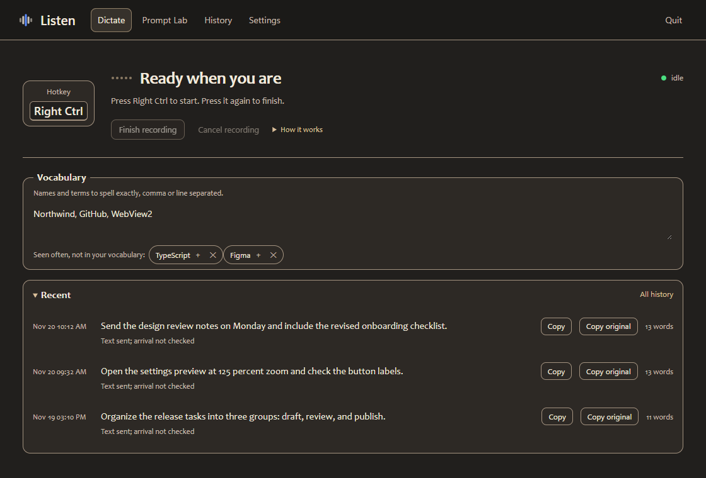
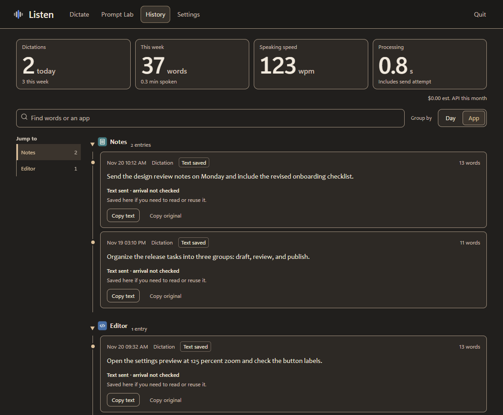
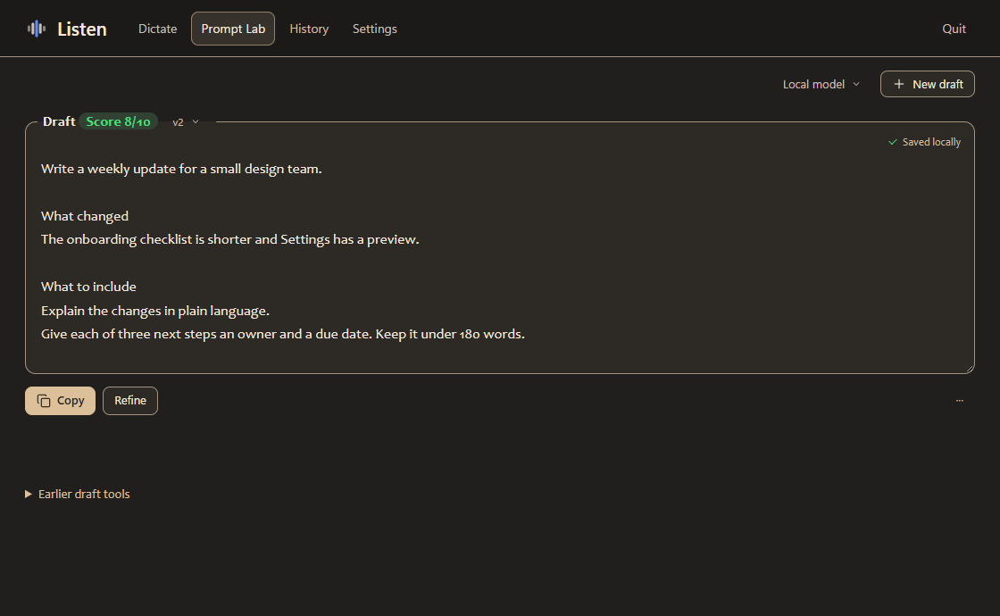
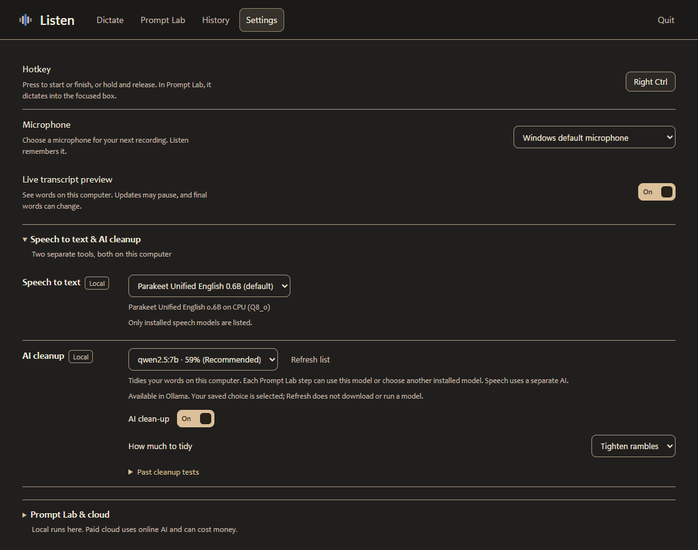

# Listen — Local speech-to-text and voice typing for Windows

Listen is a Windows dictation app that turns speech into text and types it into the app you were using when you started recording. Speech recognition runs on your computer with a supported local model. You can also tidy dictation with Ollama, browse past dictations by date or destination app, and write or review prompts in Prompt Lab.

**[Download the Windows x64 installer](https://github.com/Sczitzo/Listen/releases/latest/download/Listen-Windows-x64.msi)** · [Release notes](https://github.com/Sczitzo/Listen/releases/latest) · [Screenshots](#screenshots)

The installer includes Python. On first launch, Listen downloads and verifies the English speech model automatically. After that one-time setup, basic dictation works offline.

## What you can do

- **Dictate into other Windows apps.** Use the default **Right Ctrl** shortcut or choose a shortcut in Settings. Hold the key and release to finish, or tap to start and tap again to finish. The floating panel shows recording status and can display a live transcript.
- **Clean up text locally.** Ollama can tidy grammar and remove filler words. Listen keeps recognition and cleanup separate, so you can choose their models independently.
- **Find past dictations.** Search History or group entries by day or destination app. Recent entries show the app name and icon when Listen can identify the destination. Copy the cleaned text or the original transcript.
- **Write and review AI prompts.** Prompt Lab keeps draft revisions, shows feedback and lets you choose a local model or an optional cloud provider for each stage.

## System requirements

| Requirement | What you need |
| --- | --- |
| Windows | A 64-bit Windows PC and a microphone. The release installer is for x64. |
| Internet | First launch needs a connection to download the English speech model, about 730 MB. |
| Included setup | Listen includes its own Python and speech engine. It installs Microsoft WebView2 and Visual C++ when needed. Windows may ask for permission to install Visual C++. |
| Optional AI features | Ollama with an installed text model for local cleanup or Prompt Lab. Cloud Prompt Lab stages require the provider’s API key and can incur charges. |

## Install Listen on Windows

1. Download [**Listen-Windows-x64.msi**](https://github.com/Sczitzo/Listen/releases/latest/download/Listen-Windows-x64.msi).
2. Run the installer. It adds **Listen** to the Windows Start menu and closes when installation finishes.
3. Open **Listen** from Start. Wait for the first-run model download to finish. Listen reuses a verified copy of the model if it’s already on your PC.
4. Open the app where your words should appear. Tap **Right Ctrl** to start dictating, then tap it again to finish. If you’ve selected a different shortcut, use the one shown on the **Dictate** tab.

If a copy of Listen is already running, choose **Quit** in that copy before opening the new one from Start.

The installer runs for your Windows account and is unsigned. Upgrades from an earlier Listen MSI preserve your settings and History. To uninstall, use **Settings → Apps → Installed apps → Listen**. Your settings, History, and downloaded speech model stay on your PC. A copy run directly from a source checkout has its own saved files.

## Screenshots

These show the release interface with sample data.

### Dictate



### History



### Prompt Lab



### Settings



The cleanup model scores in Settings come from a historical 39-sample cleanup test. Performance depends on the machine and task.

## Privacy and offline use

Listen processes speech on your computer. Dictation history, preferences, and working drafts are stored locally. Ollama can handle optional text cleanup and Prompt Lab stages on the same computer. If you enable paid cloud AI for Prompt Lab, the selected provider receives the input and context for the requests you choose to run. The destination app handles inserted text according to its own settings.

Use `ANTHROPIC_API_KEY` for Claude, `OPENAI_API_KEY` for OpenAI, or `GEMINI_API_KEY` or `GOOGLE_API_KEY` for Gemini. Keep API keys in your environment and out of screenshots, issue reports, and commits.

## Frequently asked questions

### Does Listen work offline?

Yes. After the one-time download, the default English speech model runs on your PC and works offline. Optional cloud Prompt Lab requests need an internet connection.

### Which language does this build recognize?

This build is configured for English dictation. The default Parakeet model is English-only. The vocabulary list can guide optional cleanup. Parakeet uses its own recognition vocabulary.

### Why does Listen say speech is unavailable?

If first-time setup is interrupted, reconnect to the internet and choose **Try again** in the setup window. If Listen is already open, check the selected model under **Settings → Speech to text & AI cleanup**. Choose the default English model or an installed model, then use **Retry startup** when Listen offers it.

### Can I use Listen without Ollama or a paid API key?

Yes. With a supported local speech model ready, basic dictation works without Ollama or a cloud account. Ollama enables local cleanup and local Prompt Lab processing. Provider keys are for optional cloud Prompt Lab requests.

## Verification

```powershell
python tests/run_tests.py --no-devices
```

The release source passed 75 automated suites that run without hardware. A fresh hosted Windows VM verified automatic model download, sample recognition, upgrade, and uninstall. A separate live microphone check verified that the shortcut started and stopped recording and that the sentence appeared once in the focused editor. [Windows VM run](https://github.com/Sczitzo/Listen/actions/runs/44825215006) · [Regression check guide](tests/README.md)

### Build the Windows installer from source

On a Windows build machine with Git, Python 3.13 and the Windows .NET Framework C# compiler, run this from the repository root:

```powershell
py -3.13 -B packaging/windows/build_installer.py --repo . --revision v2026.11.21 --output Listen-Windows-x64.msi
```

The build fetches pinned runtime packages and packages the tagged app files using Windows Installer. The speech model download happens on first launch. For source development on a configured machine, use [`run.bat`](run.bat) or [`launch_listen.pyw`](launch_listen.pyw). [Windows packaging details](packaging/windows/README.md)

## License

Created by Sczitzo and released under the [MIT License](LICENSE).

The Windows installer includes third-party libraries, including FFmpeg through PyAV. Their licenses, corresponding source files, and build instructions are available with the installer. [Third-party source bundle](https://github.com/Sczitzo/Listen/releases/latest/download/Listen-Third-Party-Source.zip)
